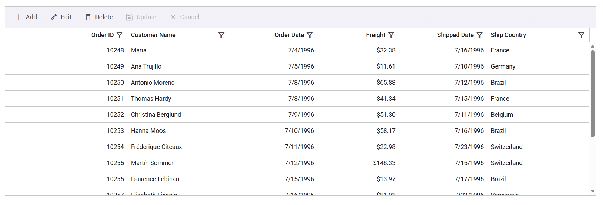

# Getting Started with Syncfusion® React Components in Tauri

A Tauri-based Syncfusion® React Sample Application is available to help you evaluate Syncfusion® React Components in native desktop and mobile environments. The sample demonstrates commonly used UI components and can be used as a reference for building cross-platform applications with React and Tauri.

This article provides a step-by-step guide for setting up a [Vite](https://vite.dev/guide/) project with Tauri and integrating Syncfusion® React components.

[Tauri](https://tauri.app/) is an application framework that enables developers to build desktop and mobile applications using web technologies such as React, HTML, CSS, and JavaScript.

By combining a web-based frontend with a lightweight native application shell, Tauri enables developers to package web applications as native applications across multiple platforms.

Syncfusion® React Components can be used within Tauri applications without requiring any special component packages or API changes. Existing React applications that use Syncfusion® React Components can be integrated with Tauri and packaged as native applications while continuing to use the same APIs, themes, and development workflow.

## Prerequisites

- Node.js 24 or later
- Syncfusion CLI
- [Tauri](https://v2.tauri.app/start/prerequisites/)

## Install the Syncfusion CLI 

Install the Syncfusion CLI globally using the following command:



npm install -g @syncfusion/syncfusion-cli



## Set up the Vite project

You can create a React Vite application using the Syncfusion CLI.

create a project directly using a single command with the required command-line arguments.



sf new my-app --framework react --template grid



In this mode, the project configuration is passed directly in the command. The above command creates a React Vite application configured with the Syncfusion&reg; `Grid` component.

## Add Tauri to the Application

Once the project is created, navigate to the project directory and run the following commands in your terminal.



cd my-app
npm install



Install the Tauri packages and initialize the project.



npm install @tauri-apps/api
npm install -D @tauri-apps/cli

npx tauri init



During initialization, Tauri generates the required configuration files and native application project structure used for packaging the React application.

For more information, refer to:

- [Create a Tauri Project](https://v2.tauri.app/start/create-project/)

## Run the Application

After integrating the required Syncfusion® React components, start the application through Tauri.



npm run tauri dev



Tauri launches a native application window and loads the React application containing the Syncfusion® components.

The output will appear as follows:

## Build the Application

Once development is complete, create a production build.



npm run tauri build



Tauri packages the React application together with the native application shell for the target platform.

For platform-specific packaging details, refer to [Tauri Distribution Guide](https://v2.tauri.app/distribute/).

## Validated Platforms

Syncfusion® React Components have been validated with Tauri on the following platforms:

| Platform | Install From | Details | Supported OS Version | Notes |
|----------|--------------|----------|----------------------|-------|
| Android | Google Play Store | Syncfusion® React for Tauri demos for Android are available through the Google Play Store. | Android 8.0 (API Level 26)+ | — |
| Windows | Microsoft Store | Syncfusion® React for Tauri demos for Windows are available through the Microsoft Store. | Windows 10/11 | Requires Microsoft WebView2 Runtime. |
| iOS | TestFlight | Due to Apple's beta distribution requirements, the Syncfusion® React for Tauri demo application is distributed through TestFlight for evaluation purposes. | iOS 9.0+ | Ensure that the TestFlight app is installed before installing the sample application. |
| macOS | ZIP File | Syncfusion® React for Tauri demos for macOS are available as downloadable packages. | macOS 10.15 (Catalina)+ | Uses the native WKWebView runtime. |
| Linux | ZIP File | Syncfusion® React for Tauri demos for Linux are available as downloadable packages. | Modern Linux distributions with WebKitGTK 4.1 support (for example, Ubuntu 22.04+, Fedora, Arch, and openSUSE) | Requires WebKitGTK 4.1 runtime libraries. |

The sample packages can be used to evaluate Syncfusion® React Components running within native Tauri applications on each platform.

Existing React applications using Syncfusion® React Components can be developed and packaged for these platforms using Tauri.

## See Also

- [System Requirements](../system-requirement)
- [Themes and Appearance](../appearance/theme)
- [License Key Registration](../licensing/license-key-registration)